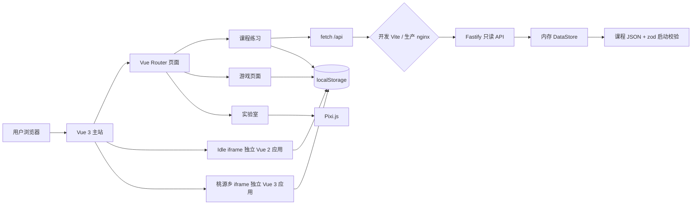
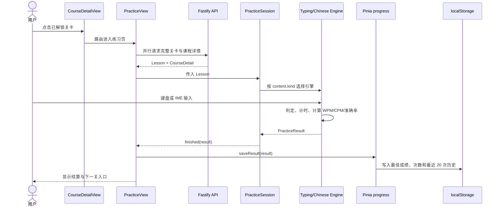

# 打字乐园（type-happy）Code Wiki

> 文档基线：2026-11-18，Git 提交 `b8b0281`。  
> 本文以当前源码和实际脚本为准；与根 README 不一致之处在“当前实现边界与文档差异”中单独说明。

## 目录

1. [项目概览](#1-项目概览)
2. [快速开始](#2-快速开始)
3. [整体架构](#3-整体架构)
4. [仓库结构与工作区](#4-仓库结构与工作区)
5. [依赖关系与技术栈](#5-依赖关系与技术栈)
6. [共享类型与 API 契约](#6-共享类型与-api-契约)
7. [服务端模块](#7-服务端模块)
8. [Web 主站模块](#8-web-主站模块)
9. [课程练习核心链路](#9-课程练习核心链路)
10. [状态管理与浏览器持久化](#10-状态管理与浏览器持久化)
11. [游戏模块](#11-游戏模块)
12. [实验室模块](#12-实验室模块)
13. [构建、SEO 与静态资源管线](#13-构建seo-与静态资源管线)
14. [测试与质量检查](#14-测试与质量检查)
15. [配置项与运行环境](#15-配置项与运行环境)
16. [生产部署](#16-生产部署)
17. [常见维护任务](#17-常见维护任务)
18. [当前实现边界与文档差异](#18-当前实现边界与文档差异)
19. [推荐阅读顺序](#19-推荐阅读顺序)

---

## 1. 项目概览

打字乐园是一个以浏览器为主要运行环境的打字练习与休闲游戏站点：

- **三类课程、共 50 关**：标准指法 20 关、英文 15 关、中文拼音 15 关。
- **两套打字引擎**：字符级引擎处理指法/英文；中文引擎处理 IME 组合输入、拼音逐音节判定和手动拼音兜底。
- **七款游戏**：打字消气球、打字打鸭子、打字街霸、放置刷装备、涂鸦跳跃、放置武林、桃源乡。
- **一个实验室功能**：基于 Pixi.js 的 Boids 群鸟模拟。
- **SEO 支持**：运行时 Head 管理、JSON-LD、sitemap/robots 生成和全路由预渲染。
- **纯本地用户数据**：成绩、进度、设置和游戏存档均保存在浏览器 `localStorage`；无账号、排行榜、数据库或成绩上传接口。

服务端仅承担课程 JSON 的校验和只读分发。业务状态、练习判分、游戏模拟与持久化主要都在客户端完成。

### 核心设计约束

1. 课程内容是构建时随服务端打包的静态数据，不支持运行时后台编辑。
2. `@type-happy/shared` 是前后端共享的编译期契约，不是独立运行服务。
3. 主站和两个 iframe 游戏是不同应用，拥有各自的依赖、路由和状态体系。
4. `apps/web/games/*` 下的独立游戏源码不在根 pnpm workspace 中，根构建不会重新编译它们。

---

## 2. 快速开始

### 2.1 环境要求

- **推荐 Node.js 22 或更高版本**，与 Docker 构建环境一致。
- 源码使用 `import.meta.dirname`，因此 Node 20 线至少需要 **20.11**；根 README 中笼统的“Node ≥ 20”并不覆盖所有 Node 20 版本。
- pnpm 版本由根 [package.json](package.json#L5) 固定为 **10.34.6**。
- 中文练习需要浏览器和系统拼音输入法；Pixi 游戏需要现代浏览器的 Canvas/WebGL 能力。

### 2.2 本地开发

```bash
corepack enable
pnpm install
pnpm dev
```

启动后：

| 服务 | 地址 | 说明 |
|---|---|---|
| Web | `http://localhost:5173` | Vue/Vite 开发服务器 |
| API | `http://localhost:3001` | Fastify 只读 API |
| 健康检查 | `http://localhost:3001/health` | 返回状态和课程数 |

`pnpm dev` 的顺序是：先构建 shared，再通过 `concurrently` 并行启动 server 与 web。Vite 将 `/api` 代理到 `http://localhost:3001`，见 [vite.config.ts](apps/web/vite.config.ts#L5-L21)。

### 2.3 常用命令

在仓库根目录执行：

| 命令 | 作用 |
|---|---|
| `pnpm dev` | 构建 shared，并并行启动前后端开发服务 |
| `pnpm build` | 按 workspace 拓扑构建 shared、server、web；**不包含预渲染** |
| `pnpm typecheck` | 对三个 workspace 包执行 TypeScript/Vue 类型检查 |
| `pnpm lint` | ESLint 检查主工程，排除 dist、node_modules、public 和嵌套游戏源码 |
| `pnpm format` | Prettier 格式化主工程 |
| `pnpm --filter @type-happy/server start` | 启动已构建的 API，需先构建 |
| `pnpm --filter @type-happy/web preview` | 预览 Web 构建产物，默认端口 4173 |
| `pnpm --filter @type-happy/web smoke` | 打字引擎与武林模拟层冒烟测试 |
| `pnpm --filter @type-happy/web prerender` | 预渲染全部路由，需完整构建及 Playwright 浏览器 |

---

## 3. 整体架构

### 3.1 运行时拓扑



### 3.2 分层职责

| 层 | 主要职责 | 不承担的职责 |
|---|---|---|
| `packages/shared` | 课程、关卡、练习结果的 TypeScript 类型 | 运行时校验、网络请求、持久化 |
| `apps/server` | 加载和校验课程 JSON，提供只读 HTTP API | 用户成绩、游戏逻辑、数据库、鉴权 |
| `apps/web/src` | 主站 UI、练习判分、游戏、SEO、浏览器存储 | 课程内容运行时写入 |
| `apps/web/games/vue-idle-game` | 独立 Vue 2 放置游戏源码 | 主站共享状态和构建管线 |
| `apps/web/games/taoyuan` | 独立 Vue 3 田园经营游戏源码 | 主站路由、主站 Pinia 和共享成绩 |
| nginx/Docker | 静态托管、API 反代、容器编排和构建期预渲染 | 业务计算 |

### 3.3 一次课程练习的跨层数据流



---

## 4. 仓库结构与工作区

### 4.1 目录说明

```text
type-happy/
├── package.json                    # 根脚本、包管理器、lint/format 工具
├── pnpm-workspace.yaml             # 仅 packages/* 与 apps/*
├── tsconfig.base.json              # strict、ES2022、bundler 解析等共享配置
├── eslint.config.js
├── docker-compose.yml              # server + web 生产编排
├── packages/
│   └── shared/
│       ├── src/index.ts            # 前后端共享类型
│       └── package.json
└── apps/
    ├── server/
    │   ├── src/
    │   │   ├── index.ts            # Fastify 启动入口
    │   │   ├── data-loader.ts      # JSON 加载、zod 校验、内存索引
    │   │   ├── routes/courses.ts   # 课程只读路由
    │   │   └── data/               # courses.json + 50 个关卡 JSON
    │   ├── scripts/gen-content.mjs # 全量课程内容生成器
    │   └── Dockerfile
    └── web/
        ├── src/
        │   ├── main.ts             # Vue/Unhead/Pinia/Router 装配
        │   ├── App.vue             # 主站壳与全局 SEO
        │   ├── api/client.ts       # 课程 API 客户端
        │   ├── router/index.ts     # 主站路由表
        │   ├── views/              # 课程、游戏、实验室页面
        │   ├── components/         # 练习组件、游戏组件、Boids
        │   ├── composables/        # 打字、游戏、统计、SEO 等逻辑
        │   ├── stores/             # progress 与 games 两个主站 store
        │   ├── games/              # Doodle/Wulin 引擎与游戏注册表
        │   ├── labs/boids/         # Boids 纯模拟层
        │   └── utils/              # 指法、键盘布局、格式化
        ├── scripts/                # SEO、预渲染、图标、smoke、e2e
        ├── public/games/           # 已构建的 iframe 游戏和 Doodle 静态资源
        ├── games/
        │   ├── vue-idle-game/      # 独立 Vue 2/npm 项目
        │   └── taoyuan/            # 独立 Vue 3/npm 项目
        ├── vite.config.ts
        ├── nginx.conf
        └── Dockerfile
```

`dist/`、`node_modules/` 是生成目录，不属于源码阅读范围。主站 `public/games/idle` 与 `public/games/taoyuan` 保存的是嵌套项目已构建产物。

### 4.2 workspace 边界

[pnpm-workspace.yaml](pnpm-workspace.yaml#L1-L3) 只包含 `packages/*` 和 `apps/*`：

| 包 | 包名 | 构建方式 |
|---|---|---|
| shared | `@type-happy/shared` | `tsc` |
| server | `@type-happy/server` | `tsc` + 复制课程 JSON |
| web | `@type-happy/web` | SEO 生成 + Vite + 入口壳缓存 |

以下两个目录虽然位于 `apps/web` 内，但**不是**上述 glob 的直接子项，因此不参与根 `pnpm -r build`：

- `apps/web/games/vue-idle-game`：npm + Vue CLI 3。
- `apps/web/games/taoyuan`：npm + Vite 8，直接构建到主站 `public/games/taoyuan`。

---

## 5. 依赖关系与技术栈

### 5.1 内部依赖方向

```mermaid
flowchart BT
    Shared[@type-happy/shared]
    Server[@type-happy/server]
    Web[@type-happy/web]
    Server -->|import type| Shared
    Web -->|import type| Shared
    Web -. HTTP /api .-> Server
```

- shared 不依赖其他内部包。
- server 和 web 不互相导入源码，只通过 HTTP 与共享类型关联。
- 当前 shared 在两侧均以 `import type` 使用，主要价值是编译期约束。
- server 的 zod Schema 与 shared 类型是两套手工同步定义，并非由 zod 自动推导。

### 5.2 主要外部依赖

| 范围 | 依赖 | 用途 |
|---|---|---|
| 根工程 | pnpm 10、TypeScript 5.9、ESLint 10、Prettier 3、concurrently | monorepo、开发并行、质量工具 |
| server | Fastify 5、`@fastify/cors`、zod 4、tsx | HTTP 服务、跨域、数据校验、TS 开发运行 |
| web 主站 | Vue 3.5、Vue Router 5、Pinia 4 | SPA、路由、响应式状态 |
| web 主站 | Vite 8、Tailwind CSS 4、`@tailwindcss/vite` | 构建和 utility-first 样式，无 tailwind.config |
| web 主站 | Unhead 3 | title/meta/canonical/JSON-LD |
| Doodle/Wulin/Boids | Pixi.js 8 | Canvas/WebGL 场景渲染 |
| 构建与测试 | Playwright、`tsx`、vue-tsc | 预渲染、图标、e2e、smoke、类型检查 |
| 桃源乡独立项目 | Vue 3、Pinia 3、Vue Router 5、Tone.js、CryptoJS、File Saver、Tailwind 3 | 独立游戏、音频、存档加密与导出 |
| Idle 独立项目 | Vue 2.6、Vuex 3、Vue Router 3、Vue CLI 3 | vendored 游戏独立构建 |

---

## 6. 共享类型与 API 契约

唯一定义文件是 [packages/shared/src/index.ts](packages/shared/src/index.ts)。

| 类型 | 关键字段 | 使用位置 |
|---|---|---|
| `CourseId` | `'fingering' \| 'english' \| 'chinese'` | 数据目录、API 参数、类型守卫 |
| `Course` | `id/title/description/lessonCount` | 课程列表与课程详情 |
| `LessonMeta` | `id/courseId/index/title/description?` | 不含正文的关卡列表项 |
| `TextContent` | `kind:'text'`、`text`、`showKeyboard` | 指法和英文课程 |
| `PinyinChar` | `char/pinyin` | 一个汉字、标点或占位字符及其读音 |
| `PinyinContent` | `kind:'pinyin'`、`chars` | 中文课程 |
| `Lesson` | `LessonMeta + content` | 练习页完整数据 |
| `CourseDetail` | `{ course, lessons }` | 课程详情 API |
| `PracticeResult` | `lessonId/wpm/cpm/accuracy/durationMs/completedAt` | 前端结算和 localStorage |

注意：`PracticeResult` 虽然位于 shared，但服务端没有接收、保存或查询它的接口。

### 内容判别联合

`Lesson.content.kind` 是前端选择引擎和展示组件的判别字段：

- `text` → `useTypingEngine` + `TypingArea`。
- `pinyin` → `useChineseEngine` + `PinyinTypingArea`。

---

## 7. 服务端模块

### 7.1 启动入口

[apps/server/src/index.ts](apps/server/src/index.ts#L1-L30) 按以下顺序执行：

1. 创建 Fastify，日志级别取 `LOG_LEVEL`，默认 `info`。
2. 注册 `@fastify/cors`，配置为 `origin: true`。
3. 调用 `loadData()`；数据错误会在监听端口前终止启动。
4. 注册 `GET /health`。
5. 通过 Fastify 插件 options 将 `DataStore` 注入课程路由。
6. 注册 `SIGINT`/`SIGTERM` 的 `app.close()` 处理。
7. 监听 `0.0.0.0:${PORT ?? 3001}`。

服务没有鉴权、数据库连接、热加载、OpenAPI、写入接口或自定义统一错误处理器。

### 7.2 数据加载器

[apps/server/src/data-loader.ts](apps/server/src/data-loader.ts) 是服务端核心模块。

| 符号 | 位置 | 说明 |
|---|---|---|
| `CourseIdSchema` | L6 | 限制三个课程 ID |
| `TextContentSchema` / `PinyinContentSchema` | L14-L23 | 两类正文的运行时校验 |
| `LessonSchema` | L25-L32 | 以 `content.kind` 为判别字段的联合 Schema |
| `DataStore` | L34-L37 | `courses: Course[]` 与 `lessons: Map<CourseId, Lesson[]>` |
| `isCourseId(value)` | L39-L41 | 基于 `safeParse` 的运行时类型守卫 |
| `toMeta(lesson)` | L43-L46 | 去除 `content`，生成列表元数据 |
| `loadData()` | L48-L88 | 同步读取全部 JSON、校验、去重、排序并构建内存索引 |

`loadData()` 的关键行为：

- 数据目录基于 `import.meta.dirname`，开发时指向 `src/data`，编译后指向 `dist/data`。
- `courses.json` 决定课程顺序；每个课程目录中的所有 `.json` 都会被当作关卡读取。
- 校验关卡 `courseId` 与目录一致，并检查同一课程内 `id`、`index` 不重复。
- 最终按数值 `index` 排序，并动态生成 `lessonCount`。
- 不检查索引连续性、文件名与 ID 一致性、跨课程 ID 唯一性，也不强制某课程只能使用某种 `content.kind`。
- 修改 JSON 后需要重启进程；容器部署还需重新构建或替换镜像。

### 7.3 路由与错误语义

实现见 [apps/server/src/routes/courses.ts](apps/server/src/routes/courses.ts#L9-L38)。

| 方法 | 路径 | 成功响应 | 404 情况 |
|---|---|---|---|
| GET | `/health` | `{ status:'ok', courses:3 }` | 无 |
| GET | `/api/courses` | `Course[]` | 无 |
| GET | `/api/courses/:courseId` | `{ course, lessons: LessonMeta[] }` | 非法或未定义课程 |
| GET | `/api/courses/:courseId/lessons/:lessonId` | 完整 `Lesson` | 非法课程或关卡 ID 不存在 |

手工 404 响应为 `{ message: string }`。其他未匹配路由和未捕获异常使用 Fastify 默认行为。

### 7.4 课程内容生成器

[apps/server/scripts/gen-content.mjs](apps/server/scripts/gen-content.mjs) 用紧凑数组维护全部课程：

| 函数 | 作用 |
|---|---|
| `cnPunct(s)` | 按内置规则转换部分中文标点，不是所有标点的通用全角化 |
| `writeLesson(...)` | 生成 `lesson-XX.json`、处理标题/说明并写文件 |
| `textLesson(...)` | 构造文本关卡 |
| `pinyinLesson(...)` | 对齐汉字与无声调拼音，标点以自身作为 `pinyin` 占位 |

执行：

```bash
node apps/server/scripts/gen-content.mjs
```

重要注意事项：

- 脚本会先删除三个课程目录下的**所有 `.json` 文件**，再全量重写；直接手改这些文件也会在下次生成时丢失。
- 中文生成器要求汉字和拼音一一对应、拼音只含 ASCII 字母，并不支持换行。
- 生成不是原子操作，中途失败可能留下部分生成结果。
- `courses.json` 不在生成器的全量重写范围内，需要单独维护。
- 根构建不会自动执行生成器。

### 7.5 服务端构建

[apps/server/package.json](apps/server/package.json#L6-L10) 的 build 为：

```bash
rm -rf dist && tsc -p tsconfig.json && cp -R src/data dist/data
```

复制 JSON 是必要步骤，因为编译后的加载器读取 `dist/data`。`start` 则直接运行 `node dist/index.js`。

---

## 8. Web 主站模块

### 8.1 应用入口与全局壳

[apps/web/src/main.ts](apps/web/src/main.ts) 依次安装：

1. Unhead `createHead()`。
2. Pinia `createPinia()`。
3. Vue Router。
4. 挂载 `App.vue` 到 `#app`。

[App.vue](apps/web/src/App.vue) 提供吸顶导航、 `<RouterView />` 和页脚，并根据路由注入 title、description、canonical、Open Graph、Twitter Card、WebSite/VideoGame JSON-LD。

### 8.2 API 客户端

[apps/web/src/api/client.ts](apps/web/src/api/client.ts)：

| 符号 | 说明 |
|---|---|
| `ApiError` | 带 HTTP `status` 的错误类；网络错误状态为 0 |
| `request<T>(path)` | 请求同源 `/api${path}`，处理网络/HTTP 错误并解析 JSON |
| `fetchCourses()` | 获取课程数组 |
| `fetchCourse(courseId)` | 获取课程详情，参数经 `encodeURIComponent` |
| `fetchLesson(courseId, lessonId)` | 获取完整关卡 |

客户端只做 TypeScript 泛型断言，没有 zod 响应校验、超时、重试、取消或请求去重。

### 8.3 路由与页面

完整路由见 [apps/web/src/router/index.ts](apps/web/src/router/index.ts#L12-L167)。所有页面组件均动态导入，实现按路由代码分割；使用 HTML5 history，导航后回到顶部，未知路径重定向首页。

| 路径 | 页面 | 主要职责 |
|---|---|---|
| `/` | `HomeView` | 产品入口、课程/游戏/实验室导航 |
| `/courses` | `CourseListView` | 并发加载各课程详情，展示完成度 |
| `/courses/:courseId` | `CourseDetailView` | 关卡状态、线性解锁和最佳成绩 |
| `/courses/:courseId/lessons/:lessonId` | `PracticeView` | 加载、练习、结算、重开和下一关 |
| `/games` | `GameListView` | 读取游戏注册表及共享成绩 |
| `/games/balloon` | `BalloonGameView` | 气球游戏说明与组件装配 |
| `/games/duck` | `DuckGameView` | 鸭子游戏说明与组件装配 |
| `/games/fighter` | `FighterGameView` | 格斗游戏说明与组件装配 |
| `/games/idle` | `IdleGameView` | iframe 加载 `/games/idle/game.html` |
| `/games/doodle` | `DoodleGameView` | Doodle 组件及成绩展示 |
| `/games/wulin` | `WulinGameView` | 武林组件及评价展示 |
| `/games/taoyuan` | `TaoyuanGameView` | iframe 加载 `/games/taoyuan/index.html` |
| `/labs` | `LabListView` | 实验功能列表 |
| `/labs/boids` | `BoidsLabView` | Boids 组件薄包装 |

路由没有鉴权或课程解锁守卫。线性解锁目前只是 `CourseDetailView` 的 UI 约束，直接访问练习 URL 不会被执行层拦截。

### 8.4 课程页面职责

| 页面/函数 | 关键行为 |
|---|---|
| `CourseListView` 加载流程 | 先取课程列表，再并发取详情；单课程详情失败只使该卡关卡为空 |
| `completedOf` / `percentOf` | 根据 progress store 计算完成数与百分比 |
| `CourseDetailView.load` | 区分 404 和其他加载错误，监听课程参数变化 |
| `unlocked(index)` | 调用 `progress.isLessonUnlocked` |
| `openLesson(index)` | 仅对 UI 中已解锁关卡执行命名路由跳转 |
| `PracticeView.load` | 并行请求完整 lesson 与课程详情；课程详情失败不阻止练习 |
| `onFinished(result)` | 比较旧最佳、保存结果、设置新纪录状态 |
| `restart()` | 增加 `sessionKey`，销毁并重建 `PracticeSession` |
| `goNext()` | 进入当前课程顺序中的下一关 |

### 8.5 样式系统

- [style.css](apps/web/src/style.css) 使用 `@import 'tailwindcss'` 和 Tailwind 4 `@theme`。
- 自定义品牌色为翡翠青色系，页面主要使用 `stone`、`brand`、`emerald`、`red`、`amber`。
- 主站没有独立 UI 组件库或 CSS Modules，主要组合 Tailwind utility class 与少量 scoped CSS。
- 虚拟键盘、手势、角色和游戏场景使用 SVG、DOM/CSS 或 Pixi，而不是统一渲染方案。

---

## 9. 课程练习核心链路

### 9.1 `PracticeSession` 装配器

[PracticeSession.vue](apps/web/src/components/PracticeSession.vue#L11-L42) 是练习 UI 与引擎之间的适配层：

- 输入 `lesson: Lesson`，输出 `finished(result)`。
- `pinyin` 创建 `useChineseEngine`；非空 `text` 创建 `useTypingEngine`。
- 中文始终显示虚拟键盘；文本课程遵循 `showKeyboard`。
- 中文主指标为 CPM，文本课程主指标为 WPM。
- 中文键盘目标是当前拼音首字母 `targetKey`；文本键盘目标是下一个原始字符。
- 两种引擎共用 `feedback`、`progress` 和 `stats` 接口。

展示组件：

| 组件 | 职责 |
|---|---|
| `TypingArea` | 文本字符着色、当前位置滚动 |
| `PinyinTypingArea` | 隐藏 input 聚焦、IME 候选窗位置、拼音逐字母着色 |
| `StatsBar` | 实时速度、准确率、用时和进度 |
| `VirtualKeyboard` | SVG 键位、目标键、Shift 和正误闪烁 |
| `HandOverlay` | 手指分工与击键手势 |
| `ResultPanel` | 结算、新旧最佳差值、重开/下一关/返回 |

### 9.2 字符级引擎：`useTypingEngine`

实现见 [useTypingEngine.ts](apps/web/src/composables/useTypingEngine.ts)。

| 符号 | 说明 |
|---|---|
| `buildChars(text)` | 按 Unicode 码点生成 `{ expected, typed, status }` |
| `useTypingEngine(text, opts)` | 创建引擎；`allowBackspace` 默认 true |
| `typeChar(key)` | 首次输入启动计时，记录正误并推进位置 |
| `handleKeydown(e)` | 处理退格、Tab、Enter、单字符和 IME/修饰键过滤 |
| `restart()` | 重建字符并复位统计 |
| `_test` | 向 Node smoke 暴露内部事件处理器 |

状态机为 `idle → running → finished`：

- 错误字符会标红并前进，不停在原位。
- 退格恢复上一字符的 pending 状态，但不回滚历史总判定数和错误数。
- 只有到达末尾且最后一个字符正确才完成；最后字符打错时需要退格修正。
- composition 期间、`isComposing` 或 `keyCode===229` 时忽略输入。
- 全局 `keydown/compositionstart/compositionend` 监听在卸载时移除。

### 9.3 中文引擎：`useChineseEngine`

实现见 [useChineseEngine.ts](apps/web/src/composables/useChineseEngine.ts)。

| 符号 | 说明 |
|---|---|
| `normalizePinyin(input)` | 转小写并删除非 `a-z` 字符 |
| `updateLiveLetters()` | 组合阶段跨连续汉字逐字母着色，仅影响视觉 |
| `applyJudgment(correct)` | 判定当前字、推进位置、记录统计，末尾立即完成 |
| `resolveManualBuffer()` | 无 IME 时处理完整匹配、前缀等待和冲突判错 |
| `handleImeCommit(text, source)` | 上屏后按音节切片；汉字比较拼音，不比较字形 |
| `handleDirectInput(data)` | 直接处理字母、空格、标点和数字 |
| `handleComposition*` / `handleInput` | 兼容不同浏览器事件顺序并去重 |
| `handleKeydown` | 组合外退格：先删手动缓冲，再回退上一字 |

关键规则：

- 组合拼音阶段不启动计时、不判定成绩；首次上屏或直接输入才启动。
- 同音字可判对，因为目标是拼音音节，而非上屏汉字字形。
- 拼音不匹配会标错并前进，不阻塞练习。
- 标点、数字等直接按字符相等判定。
- 无 IME 时以手动拼音缓冲兜底；空格可分隔音节，不完整缓冲会被清空而不判错。
- 与文本引擎不同，中文最后一字即使判错也会进入 finished。
- 多音字不在运行时消歧，读音由课程 JSON 固定。

浏览器事件兼容：

| 浏览器顺序 | 去重方式 |
|---|---|
| Chrome：`compositionend → input` | end 中立即判定，并用 `pendingCompositionCommit` 跳过后续 input |
| Safari：`input → compositionend` | input 中先判定并记录 session，后续 end 检查 `committedSession` 后跳过 |

### 9.4 统计：`useStats`

[useStats.ts](apps/web/src/composables/useStats.ts) 提供 `markStart`、`recordKey`、`setCorrectChars`、`finish`、`reset`。

| 指标 | 公式 |
|---|---|
| 用时 | `endTime ?? now - startTime`，非负 |
| WPM | `round(correctChars / 5 / minutes)` |
| CPM | `round(correctChars / minutes)` |
| 准确率 | `round((totalKeys - wrongKeys) / totalKeys * 1000) / 10` |
| 空输入准确率 | 100 |

计时中每 200ms 刷新一次显示。退格不删除历史错误，但重打正确可恢复 `correctChars`。中文一次 `recordKey` 对应一个目标字，而不是一个拼音字母。

### 9.5 虚拟键盘与指法

| 文件/符号 | 作用 |
|---|---|
| [keyboardLayout.ts](apps/web/src/utils/keyboardLayout.ts) `KEY_ROWS` | 五行、每行 15 标准键单位的数据驱动布局 |
| `keyCenter(code)` | 计算 SVG 键中心，供手势定位 |
| [fingerMap.ts](apps/web/src/utils/fingerMap.ts) `fingerOfKey` | 返回左右手 8 指或拇指分工 |
| `resolveKey(char)` | 解析空格、Enter、Tab、大写和上档符号，返回基础键及 Shift 需求 |
| `VirtualKeyboard` | 高亮目标键、对侧 Shift，并根据 feedback ID 闪烁 250ms |
| `HandOverlay` | 将活动手指指尖过渡到目标键中心，显示 idle/active/flash 状态 |

大写或上档符号要求高亮目标键对侧的 Shift；空格使用拇指提示。

---

## 10. 状态管理与浏览器持久化

### 10.1 主站课程进度

[stores/progress.ts](apps/web/src/stores/progress.ts) 使用键 **`type-happy:progress:v1`**：

```ts
Record<lessonId, {
  best: PracticeResult
  attempts: number
  history: PracticeResult[] // 最多 20 条，最新在前
}>
```

| 符号 | 说明 |
|---|---|
| `isBetterResult(a,b)` | 先比 WPM，同分再比准确率；中文也沿用此规则 |
| `saveResult(result)` | 增加 attempts、更新历史、按需替换 best 并整表写回 |
| `isLessonUnlocked(ids,index)` | 第一关开放，其余只要求上一关存在记录 |
| `isCompleted(id)` | 只检查是否有记录，无准确率门槛 |
| `completedCount(ids)` | 统计已完成关卡数 |

读取时损坏的单条记录会被丢弃；JSON 或 localStorage 整体不可用则退化为空对象。写入失败被静默忽略，内存状态仍会更新。成绩只按 `lessonId` 索引，当前通过 `f-/e-/c-` 前缀避免跨课程冲突，但 schema 不强制全局唯一。

### 10.2 主站共享游戏成绩

[stores/games.ts](apps/web/src/stores/games.ts) 使用键 **`type-happy:games:v1`**：

```ts
Record<gameId, { bestScore: number; bestCombo: number; plays: number }>
```

`recordScore(gameId, score, bestCombo)` 会增加 plays、分别保留最高分数/连击，并返回是否刷新最高分。Balloon、Duck、Fighter、Doodle 在局末调用；Wulin 在携带角色离开或卸载时写入当前评价；Idle 和桃源乡没有主站成绩桥接。

### 10.3 全部已知存储键

| localStorage 键 | 所属模块 | 内容 |
|---|---|---|
| `type-happy:progress:v1` | 主站课程 | 最佳成绩、次数、最近 20 次历史 |
| `type-happy:games:v1` | 主站游戏 | 共享最高分、最高连击、次数 |
| `type-happy:doodle-jump:v1` | Doodle | 设置、主题字段、统计、任务、成就、教程 |
| `type-happy:wulin:v1` | Wulin | 角色、地图、技能、任务、时间戳、传承和设置 |
| `_sd` | Idle | 独立 Base64 角色存档 |
| `version`、`checkedUpdateInfo` | Idle | 独立版本和更新状态 |
| `taoyuanxiang_save_0/1/2` | 桃源乡 | 三个 AES 加密存档槽 |
| `taoyuan_privacy_agreed` | 桃源乡 | 隐私确认标记；当前只写不读 |

没有服务端同步、跨标签页同步或统一存档格式。iframe 游戏与主站同源且未设置 sandbox，因此隔离主要是应用边界，不是 origin 或 localStorage 隔离。

---

## 11. 游戏模块

### 11.1 总览

游戏元数据集中在 [src/games/list.ts](apps/web/src/games/list.ts)，首页和游戏列表共用 `GAMES` 注册表。

| 游戏 | 实现 | 核心模块 | 主站成绩 |
|---|---|---|---|
| 打字消气球 | Vue 3 + SVG/DOM | `useKeyGame` + `BalloonGame.vue` | 分数、连击、局数 |
| 打字打鸭子 | Vue 3 + SVG/DOM | `useKeyGame` + `DuckGame.vue` | 分数、连击、局数 |
| 打字街霸 | Vue 3 + DOM/CSS | `useFightGame` + `FighterGame.vue` | 总伤害、连击、局数 |
| 放置刷装备 | 独立 Vue 2，iframe | `games/vue-idle-game` | 无桥接 |
| 涂鸦跳跃 | Vue 3 + Pixi.js 8 | `DoodleGame`、`RunTracker`、独立 save | 分数和局数，另有详细存档 |
| 放置武林 | Vue 3 + Pixi.js 8 | `WulinSim`、`Combat`、水墨 render | 当前评价和离开次数，另有详细存档 |
| 桃源乡 | 独立 Vue 3，iframe | `games/taoyuan` | 无桥接 |

共享 UI 包括 `GameHud`（生命、分数、连击、暂停/重开）和 `GameOverlay`（开始、暂停、结算）。

### 11.2 Balloon 与 Duck：`useKeyGame`

[useKeyGame.ts](apps/web/src/composables/useKeyGame.ts) 通过 `requestAnimationFrame` 驱动目标生成、上升、摆动、逃逸和命中动画。

| 函数 | 作用 |
|---|---|
| `pickKey()` | 尽量避免同屏目标使用重复按键 |
| `spawn()` | 根据区域、安全边距、最大同屏数生成目标 |
| `registerMiss()` | 扣分、清连击、扣生命并触发结束 |
| `frame(ts)` | 限制 `dt ≤ 0.05s`，更新生成和运动 |
| `pressKey(rawKey)` | 命中同键中最靠近顶部目标；错键只计错和清连击 |
| `start/pause/resume/togglePause` | 游戏生命周期 |

状态为 `idle/running/paused/over`。Space/Enter 开始或继续，Escape 暂停；卸载时清理 RAF、键盘监听和效果定时器。两个游戏主要通过目标变体、数量、速度、摆动和动画参数区分。

### 11.3 Fighter：`useFightGame`

[useFightGame.ts](apps/web/src/composables/useFightGame.ts) 以 `intro/word/attack/ko` 阶段管理限时单词战斗。

- 双方初始 HP 100。
- 简单、中等、困难单词分别对应波动拳 8、龙卷旋风脚 12、升龙拳 16 基础伤害。
- 连续成功附加最多 4 点连击伤害；错字或超时立即触发 Ken 反击。
- 单词时限为 `1.5 + 0.55 × 单词长度` 秒，困难词概率随时间上升。
- 仅单词输入阶段允许暂停；KO 窗口重开会先结算已确定结果。

`FighterGame.vue` 将引擎事件映射为角色姿态、飞行道具、受击、震屏和 KO 动画，主站分数取玩家累计输出伤害。

### 11.4 Doodle Jump

核心文件：

| 文件/符号 | 职责 |
|---|---|
| [game.ts](apps/web/src/games/doodle-jump/game.ts) `DoodleGame` | Pixi 场景、平台/怪物/道具生成、物理、碰撞、射击、死亡 |
| `DoodleGame.start/stop/shoot/update/destroy` | 一局游戏的生命周期和逐帧更新 |
| [trackers.ts](apps/web/src/games/doodle-jump/trackers.ts) `RunTracker` | 将引擎事件转换为局内统计、任务和成就进度 |
| `selectMissions(...)` | 保留活跃任务，再按定义顺序补充适用任务，默认 3 个 |
| [save.ts](apps/web/src/games/doodle-jump/save.ts) | 默认档、嵌套默认值合并、容错加载和持久化 |
| `DoodleJumpGame.vue` | 资源加载、输入、Pixi 初始化、局末双 store 写入和界面 |

结束后先 `tracker.endRun()`，再保存 Doodle 详细存档，并调用主站 `recordScore('doodle', score, 0)`。DEV 下暴露 `window.__doodle` 供 e2e 使用。

当前实现边界：默认仅解锁并启用 `original`；统计固定写入 `stats.original`，任务选择不是随机洗牌。README 中“主题选择/按主题统计、每局随机三个任务”的描述超前于当前代码。

### 11.5 放置武林

武林采用 **Vue DOM 面板 + 纯 TS 模拟 + Pixi 场景 + 类型化内容数据** 的分离结构。

#### 模拟层

| 模块 | 关键符号与职责 |
|---|---|
| [sim/index.ts](apps/web/src/games/wulin/sim/index.ts) | `WulinSim` 总编排器；持有 save/combat/timeOffset，串联地图、战斗、任务、训练和持久化 |
| `WulinSim.settle/fastForward` | 常规懒结算和测试时间快进 |
| `WulinSim.createCharacter/moveTo/travelTo/pickup` | 建角与地图交互 |
| [sim/character.ts](apps/web/src/games/wulin/sim/character.ts) | `charLevel`、`effectiveAttrs`、`panel`、`evaluation`、`rollOrigin`、`skillLevelCap` |
| [sim/combat.ts](apps/web/src/games/wulin/sim/combat.ts) | `Combat`、`buildPlayer`、`buildNpc`，处理行动条、命中、伤害和战斗事件 |
| [sim/training.ts](apps/web/src/games/wulin/sim/training.ts) | 请教、练功、闭关、研究、打坐及对应时间结算 |
| [sim/idle.ts](apps/web/src/games/wulin/sim/idle.ts) | `idleRate`、`settleIdle`、`settleOffline`、`settleAll` |
| [sim/quests.ts](apps/web/src/games/wulin/sim/quests.ts) | 每日滚动、采集、日常、签到和门派任务 |
| [sim/inheritance.ts](apps/web/src/games/wulin/sim/inheritance.ts) | 传承资格、救援、弟子培养和转世 |

`WulinSim` 构造时先滚动每日状态，再按 `lastSeen` 离线结算，最后执行常规结算。`timeOffset` 支持确定性测试；快速节奏收益倍率为 5，标准为 1。

#### 表现与内容

- `render/mapScene.ts`：房间、出口、NPC、拾取物、练功点和行走动画。
- `render/battleScene.ts`：消费战斗事件，渲染攻击、命中、治疗、眩晕、死亡和血条。
- `render/ink.ts`：程序化水墨人物、武器、背景、粒子和浮字。
- `audio.ts`：WebAudio 程序合成音效。
- `data/`：章节、出身、技能、门派、物品和 NPC 等类型化内容。
- `components/games/wulin/`：创建、江湖、武学、背包、门派、角色、NPC 和战斗面板。

`WulinGame.vue` 每 5 秒 `settle()`、每 15 秒 `persist()`，页面隐藏和卸载时保存。详细存档支持 UTF-8 安全 Base64 导入导出和旧任务数据迁移；DEV 暴露 `window.__wulin`。

### 11.6 Idle：独立 Vue 2 项目

- 源码：[apps/web/games/vue-idle-game](apps/web/games/vue-idle-game)。
- 独立 Vue 2.6 + Vuex 3 + Vue Router 3 + Vue CLI 3，使用自身 npm 依赖。
- hash 路由和 `publicPath:'./'` 适配 iframe 子路径部署。
- 主站 [IdleGameView.vue](apps/web/src/views/IdleGameView.vue) 只嵌入 `/games/idle/game.html`，没有 `postMessage` 或共享 store 桥接。
- 已本地化，运行时不依赖原云端接口；详细状态由自己的 Vuex 和 localStorage 管理。
- 普通根构建只复制 `public/games/idle` 的已有产物，不重新编译 vendored 源码。

入口命名为 `game.html` 是为了避免 `/games/idle` 的预渲染快照 `games/idle/index.html` 覆盖 iframe 入口。

### 11.7 桃源乡：独立 Vue 3 项目

桃源乡不是主站内的普通游戏组件，而是拥有独立 Vue App、Pinia、hash Router 和 npm 锁文件的完整 SPA。

#### 应用结构

| 模块 | 职责 |
|---|---|
| `src/main.ts` | 创建独立 App/Pinia/Router，并为 setup stores 增加 `$reset()` |
| `src/router/index.ts` | 主菜单、`GameLayout` 和 24 个游戏子面板；使用 hash history |
| `MainMenu.vue` | 新游戏、三槽位加载/删除、`.tyx` 导入导出 |
| `GameLayout.vue` | 游戏壳、时钟、全局弹窗、手动/自动保存 |
| `useGameStore` | 年/季/日/小时、天气、位置、体力和跨日 |
| `useGameClock` | 每 700ms 现实时间推进 1 游戏分钟，支持暂停和 1–3 倍速 |
| `useEndDay` | 跨 store 日结编排，调用 `nextDay()` 并自动存档 |
| `useSaveStore` | 聚合 27 个领域 store 的序列化，提供三槽位和加密导入导出 |

当前共有 28 个 store 模块，覆盖核心状态、物品经济、生产经营、探索收集、成长社交等领域。`useSaveStore` 是持久化聚合器，业务 store 通过 `serialize/deserialize` 参与，而不是分别直接访问 localStorage。

存档键为 `taoyuanxiang_save_0`、`taoyuanxiang_save_1`、`taoyuanxiang_save_2`，数据经 CryptoJS AES 加密；导出文件扩展名为 `.tyx`。当前源码没有云端同步或外部服务请求。

#### 与主站的构建和运行边界

[apps/web/games/taoyuan/vite.config.ts](apps/web/games/taoyuan/vite.config.ts) 设置：

- `base:'./'`，资源使用相对路径。
- `outDir:'../../public/games/taoyuan'`。
- `emptyOutDir:true`，每次直接重建主站 public 中的静态目录。

主站只通过 iframe 加载产物；根构建不会先构建桃源乡。源码更新后必须先运行其独立 build，再构建主站。

---

## 12. 实验室模块

当前实验室只有 Boids 群鸟算法。

| 文件 | 职责 |
|---|---|
| `LabListView.vue` | 本地实验项目注册与入口 |
| `BoidsLabView.vue` | `BoidsLab` 的薄路由包装 |
| `components/labs/BoidsLab.vue` | Pixi 初始化、纹理、输入、resize、参数 UI 和资源销毁 |
| [labs/boids/simulation.ts](apps/web/src/labs/boids/simulation.ts) | 与渲染无关的纯模拟层 |

`BoidsSimulation` 使用 `Float32Array` 保存最多 1000 只鸟的位置和速度，并通过空间哈希网格降低邻居查询成本。

| 方法/属性 | 说明 |
|---|---|
| `setCount(n)` | 在 100–1000 范围内调整规模 |
| `scatter()` | 随机落位并重启“混乱到集群”的过渡 |
| `cohesion` | 由内部时间和 `rampDuration` 计算的 smoothstep 进度 |
| `movePointer/releasePointer` | 指针引导及失效 |
| `pulse(...)` | 点击产生局部斥力脉冲 |
| `step(dt)` | 分离、对齐、聚合、全局弱引力、指针和随机扰动更新 |
| `buildGrid(...)` | 私有空间网格重建 |

默认约 12 秒从随机扰动逐渐过渡到群体规则主导，鸟群采用环形绕边。

---

## 13. 构建、SEO 与静态资源管线

### 13.1 根构建与 Web 构建

根 `pnpm build` 使用 `pnpm -r build`，按依赖拓扑执行三个 workspace 包。

Web 的 build 定义见 [apps/web/package.json](apps/web/package.json#L6-L12)：

```text
gen-seo.mjs → vite build → save-shell.mjs
```

普通 `pnpm build` **不执行** `prerender.mjs`；Docker Web 构建会在 `PRERENDER=true` 时额外执行它。

### 13.2 路由收集、sitemap 和 robots

[scripts/seo-routes.mjs](apps/web/scripts/seo-routes.mjs) 是 sitemap 与预渲染共用的路由来源：

- 首页、课程列表、游戏列表。
- 七个游戏路由。
- 实验室列表和 Boids。
- 三个课程详情页。
- 从课程 JSON 展开的 50 个练习页。

当前合计 **65 个 URL**。`gen-seo.mjs` 根据 `SITE_URL` 生成 `public/sitemap.xml` 与 `public/robots.txt`，并禁止爬虫访问 `/api/`。

### 13.3 运行时 SEO

- `App.vue`：全站 title/description/canonical/OG/Twitter Card，以及 WebSite、VideoGame JSON-LD。
- `useSeo.ts`：`SITE_ORIGIN`、`withSite`、`useBreadcrumb`、`useItemListSeo`。
- 课程详情和练习页在数据加载后覆盖标题、描述并生成 BreadcrumbList。
- `SITE_ORIGIN` 优先取 `VITE_SITE_URL`；开发回退当前 origin，生产回退 `https://type.toby-blog.com`。

### 13.4 预渲染

[scripts/prerender.mjs](apps/web/scripts/prerender.mjs) 的流程：

1. 要求 `apps/web/dist/index.html` 和 `apps/server/dist/index.js` 已存在。
2. 从 `node_modules/.cache/prerender-shell.html` 恢复干净 SPA 壳。
3. 启动构建后的 server，默认端口 3101，`LOG_LEVEL=silent`。
4. 启动 Vite preview，默认端口 4173，并把 `/api` 代理到预渲染 API。
5. 启动 Playwright Chromium，默认 4 并发。
6. 优先等待 `networkidle`，失败时退化为 `load + 3s`。
7. 序列化 DOM、归一化 preview 绝对地址，写入 `dist/<route>/index.html`。
8. 首页最后渲染，避免首页快照污染其他路由的 SPA fallback。
9. 任一路由失败会汇总并按失败流程结束。

本地执行前需要安装浏览器：

```bash
pnpm --filter @type-happy/web exec playwright install chromium
pnpm build
pnpm --filter @type-happy/web prerender
```

可通过 `PRERENDER_CHANNEL=chromium-headless-shell` 使用 Docker 同款浏览器通道，但需安装对应 headless shell。

### 13.5 入口壳与图标

- `save-shell.mjs` 在 Vite 构建后缓存原始 `dist/index.html`，使重复预渲染不会互相污染。
- `gen-icons.mjs` 从 `public/favicon.svg` 生成 32/180/192/512 PNG 和 16/32/48 ICO。
- `manifest.webmanifest` 是独立维护的静态文件，**不由** `gen-icons.mjs` 生成。
- 图标脚本使用 Playwright，只有设计稿变化时需要手动执行。

---

## 14. 测试与质量检查

### 14.1 测试入口

| 命令/脚本 | 覆盖范围 | 前置条件 |
|---|---|---|
| `pnpm typecheck` | shared/server/web 静态类型 | 安装依赖 |
| `pnpm lint` | 主工程 ESLint | 安装依赖；不覆盖嵌套游戏源码 |
| `pnpm --filter @type-happy/web smoke` | 文本/中文引擎、Wulin 模拟和存档 | 无需浏览器 |
| `node apps/web/scripts/e2e-doodle.mjs` | Doodle 加载、输入、死亡、存档、任务/成就/设置 | 5199 DEV server |
| `node apps/web/scripts/e2e-wulin.mjs` | 武林建角、地图、战斗、挂机、面板、传承等 | 5199 DEV server |
| `node apps/web/scripts/e2e-taoyuan.mjs` | 桃源 iframe、导航、共存、控制台和本地存储边界 | 按脚本要求启动主站 |

Doodle/Wulin e2e 依赖只在 DEV 暴露的 `window.__doodle`、`window.__wulin`，不能用生产 preview 替代。

Doodle 和 Wulin 的标准运行方式：

```bash
# 终端 1
pnpm --filter @type-happy/web exec vite --port 5199

# 终端 2，分别执行
E2E_BASE=http://localhost:5199 node apps/web/scripts/e2e-doodle.mjs
E2E_BASE=http://localhost:5199 node apps/web/scripts/e2e-wulin.mjs
```

Node smoke 在组件实例外调用 composable，因此会打印 Vue `onMounted/onBeforeUnmount` 生命周期警告；当前测试仍正常完成。

### 14.2 本次文档编制时的验证结果

验证环境：Node `v24.21.0`、pnpm `10.34.6`。

| 项目 | 结果 |
|---|---|
| `pnpm typecheck` | 通过 |
| `pnpm lint` | 通过 |
| `pnpm --filter @type-happy/web smoke` | 60/60 通过 |
| `pnpm build` | 通过，Vite 891 个模块，SEO 输出 65 个 URL |
| `GET /health` | 实测返回 `{ "status":"ok", "courses":3 }` |
| `GET /api/courses` | 实测返回三课程，关卡数为 20/15/15 |
| 全路由预渲染 | 未完成：本机缺少 Playwright Chromium，浏览器启动前终止 |
| Doodle/Wulin/桃源 e2e | 本次未运行 |
| Docker Compose | 本次未运行 |

---

## 15. 配置项与运行环境

| 变量 | 默认值 | 使用位置与作用 |
|---|---|---|
| `PORT` | `3001` | Fastify 监听端口 |
| `LOG_LEVEL` | `info` | Fastify 日志级别；预渲染设为 `silent` |
| `PRERENDER_API` | `http://localhost:3001` | Vite dev/preview 的 `/api` 代理目标 |
| `PRERENDER_PORT` | `4173` | Vite preview 与预渲染访问端口 |
| `PRERENDER_API_PORT` | `3101` | 预渲染临时 API 端口 |
| `PRERENDER_CONCURRENCY` | `4` | 预渲染页面并发数 |
| `PRERENDER_CHANNEL` | 空 | Playwright 浏览器通道；Docker 为 `chromium-headless-shell` |
| `SITE_URL` | `https://type.toby-blog.com` | sitemap/robots 的站点地址 |
| `VITE_SITE_URL` | 生产回退正式域名 | 前端 canonical/OG/JSON-LD 地址 |
| Docker `PRERENDER` | `true` | 是否安装浏览器并执行全路由预渲染 |
| `E2E_BASE` | 各脚本默认值 | e2e 访问的 DEV server 地址 |

Compose 中 server 固定 `NODE_ENV=production`、`PORT=3001`。生产 Web 构建同时把 `SITE_URL` 映射为 `VITE_SITE_URL`。

---

## 16. 生产部署

### 16.1 手动构建运行

```bash
pnpm install --frozen-lockfile
pnpm build
pnpm --filter @type-happy/server start
```

另开进程预览或托管 Web：

```bash
pnpm --filter @type-happy/web preview
```

真正生产环境建议使用 nginx 等静态服务器托管 `apps/web/dist`，并把 `/api` 与 `/health` 反代到 server。若需要 SEO 快照，还需在托管前成功执行预渲染。

### 16.2 Docker Compose 拓扑

```bash
docker compose up -d --build
```

设计上的生产拓扑：

| 容器 | 运行内容 | 端口 |
|---|---|---|
| server | 非 root Node 用户运行 Fastify 编译产物 | 内网 3001，默认不发布宿主机 |
| web | nginx:alpine 托管静态 dist 并反代 API | 宿主机 `8088:80` |

Web 等待 server 的 `/health` 健康检查通过后启动。两个 Dockerfile 都必须以**仓库根目录**作为构建上下文。

常用操作：

```bash
docker compose logs -f
docker compose down
docker compose build
```

可配置示例：

```bash
SITE_URL=https://example.com PRERENDER=false docker compose up -d --build
```

`PRERENDER=false` 可减少构建资源，但不会生成 SEO 快照，也不能解决下文桃源乡路径冲突。

### 16.3 Web 镜像阶段

[apps/web/Dockerfile](apps/web/Dockerfile)：

1. Node 22 Bookworm Slim 安装 workspace 依赖。
2. `PRERENDER=true` 时安装 Chromium Headless Shell。
3. 依次构建 shared、server、web。
4. 默认继续执行全路由预渲染。
5. 最终镜像只复制 dist 和 nginx 配置到 `nginx:1.27-alpine`，不带 Node、Playwright 或 Chromium。

### 16.4 Server 镜像阶段

[apps/server/Dockerfile](apps/server/Dockerfile) 使用构建、生产依赖、运行三个阶段：

- 构建 shared/server 并复制课程数据。
- 只安装 server 的生产依赖。
- 以 `node` 非 root 用户运行 `apps/server/dist/index.js`。
- 每 10 秒请求 `/health`，失败 5 次视为不健康。

### 16.5 nginx 行为

[apps/web/nginx.conf](apps/web/nginx.conf)：

- `/assets/` 哈希资源长缓存；游戏和静态资源 7 天；sitemap/robots 1 小时；HTML/API no-cache。
- `/api/` 与 `/health` 反代到 `server:3001`。
- 使用 Docker DNS `127.0.0.11` 和变量形式 `proxy_pass`，后端换 IP 后无需 reload。
- `absolute_redirect off` 适配上游 TLS 终止代理。
- `try_files $uri $uri/index.html /index.html` 依次匹配真实文件、预渲染快照和 SPA 壳。

### 16.6 当前默认部署的阻塞点

桃源乡同时存在：

1. 主站/预渲染路由 `/games/taoyuan`。
2. 静态 iframe 文件 `public/games/taoyuan/index.html`。
3. iframe `src="/games/taoyuan/index.html"`。

预渲染 `/games/taoyuan` 时，目标快照同样是 `dist/games/taoyuan/index.html`。[prerender.mjs](apps/web/scripts/prerender.mjs#L109-L116) 的冲突保护会检测 `public/games/taoyuan/index.html` 并记录失败，随后进入失败汇总。因此按当前控制流，**默认 `PRERENDER=true` 的 Docker Web 构建会在安装浏览器后遇到该冲突**。

本次本地预渲染因缺少浏览器未实际执行到该路由，但冲突条件与失败分支可由源码直接确定。

即使设 `PRERENDER=false`，nginx 对 `/games/taoyuan` 也会优先匹配 `$uri/index.html` 的静态游戏入口，而不是主站 SPA 页面，因此该选项不是路径语义修复。部署前应像 Idle 一样重新规划桃源静态入口文件名并同步 iframe 地址，或调整路由/静态目录设计。

---

## 17. 常见维护任务

### 17.1 修改现有课程或增加关卡

推荐编辑 [gen-content.mjs](apps/server/scripts/gen-content.mjs) 中对应课程数组，然后执行：

```bash
node apps/server/scripts/gen-content.mjs
pnpm --filter @type-happy/server build
```

开发服务由 `tsx watch` 监听 TS，但 JSON 内容没有热加载协议，重新生成后应重启 server。新增/删除关卡后，下一次 Web build 会根据 JSON 自动更新 sitemap 和预渲染路由。

若增加第四种课程，还需同步修改：

- shared 的 `CourseId`。
- server 的 `CourseIdSchema`。
- `courses.json` 和生成器课程列表。
- `seo-routes.mjs` 中硬编码的课程 ID 列表。
- 课程文案及必要的前端展示逻辑。

### 17.2 直接手写课程 JSON

文本关卡：

```json
{
  "id": "e-16",
  "courseId": "english",
  "index": 16,
  "title": "新关卡",
  "content": {
    "kind": "text",
    "text": "Practice text.",
    "showKeyboard": false
  }
}
```

中文关卡使用 `kind:'pinyin'` 和 `chars:[{char,pinyin}]`。直接手写的文件会被下一次内容生成器删除，因此只适合不准备再运行生成器的维护方式。为避免主站成绩冲突，应确保 lesson ID 在全站唯一，而不只是课程内唯一。

### 17.3 更新 Idle 游戏

```bash
cd apps/web/games/vue-idle-game
npm install --legacy-peer-deps
npm run build
rsync -a --delete dist/ ../../public/games/idle/
mv ../../public/games/idle/index.html ../../public/games/idle/game.html
```

然后回到仓库根目录重新执行 `pnpm build`。保留 `game.html` 命名以避免预渲染冲突。

### 17.4 更新桃源乡游戏

```bash
cd apps/web/games/taoyuan
npm install
npm run build
```

该 build 先执行 `vue-tsc -b`，再直接清空并重建 `apps/web/public/games/taoyuan`。随后回到根目录构建主站。不要只运行根 `pnpm build` 并期待桃源乡源码被重新编译。

### 17.5 新增主站游戏或实验页面

通常需要同步：

1. 新增视图和必要的引擎/组件。
2. 在 `router/index.ts` 注册路由及 SEO meta。
3. 游戏还需在 `src/games/list.ts` 注册卡片元数据。
4. 在 `scripts/seo-routes.mjs` 添加需要收录和预渲染的路径。
5. 若产生共享成绩，调用 `useGamesStore.recordScore`；独立详细进度使用单独版本化存储键。
6. 增加 smoke/e2e，并验证构建和预渲染路径不会与 public 文件冲突。

---

## 18. 当前实现边界与文档差异

### 18.1 架构和工程边界

| 主题 | 当前实际行为 |
|---|---|
| 用户数据 | 仅浏览器本地，无云同步、账号或排行榜 |
| 课程解锁 | 仅课程详情 UI 限制，直接练习 URL 可绕过 |
| 成绩索引 | 仅 lessonId，不自动包含 courseId 命名空间 |
| 中文最佳成绩 | 虽然界面主指标为 CPM，最佳比较仍先比 WPM |
| 类型契约 | shared TS 类型和 server zod Schema 需要手工同步 |
| 客户端响应 | 仅泛型断言，无运行时 schema 校验 |
| 异步请求 | 无取消、超时、重试和竞态保护 |
| 统计数据 | 中途离开不保存本次练习；运行中的统计 interval 主要由 finish/reset 清理 |
| 嵌套项目 | 不参与根 workspace 的类型检查、lint 或构建 |
| iframe 隔离 | 同源、无 sandbox、无父子消息桥接 |
| 内容加载 | server 启动时一次性加载，无热更新 |

### 18.2 根 README 与当前代码的主要差异

| 根 README 表述 | 当前代码事实 |
|---|---|
| Node ≥ 20 | `import.meta.dirname` 要求 Node 20.11+，推荐 Node 22+ |
| 六个游戏 | 实际注册七款，另有桃源乡 |
| sitemap/预渲染 64 个 URL | 当前实际为 65 个 |
| `gen-icons` 同时生成 manifest | manifest 是独立静态文件 |
| 预渲染使用随机高位端口 | 默认固定 API 3101、preview 4173，可由环境变量覆盖 |
| Doodle 每局随机 3 任务、按主题统计和主题解锁 | 任务按定义顺序补齐；统计固定 original；当前无完整主题选择流程 |
| 内容生成器“清空目录/旧 lesson-*.json” | 实际删除三个课程目录下所有 `.json` |
| 桃源乡未列入主文档 | 已有独立源码、路由、iframe、静态产物和 e2e |
| 默认 Docker 预渲染可直接完成 | 当前桃源乡快照与静态 `index.html` 存在冲突 |

这些差异不影响本次实测的普通 `pnpm build`，但会影响文档维护、功能预期和默认生产预渲染。

---

## 19. 推荐阅读顺序

### 新成员快速理解主链路

1. [packages/shared/src/index.ts](packages/shared/src/index.ts)：先理解数据模型。
2. [apps/server/src/index.ts](apps/server/src/index.ts) 与 [data-loader.ts](apps/server/src/data-loader.ts)：理解只读 API 和数据来源。
3. [apps/web/src/router/index.ts](apps/web/src/router/index.ts)：建立页面地图。
4. [PracticeView.vue](apps/web/src/views/PracticeView.vue) 与 [PracticeSession.vue](apps/web/src/components/PracticeSession.vue)：理解练习装配。
5. [useTypingEngine.ts](apps/web/src/composables/useTypingEngine.ts)、[useChineseEngine.ts](apps/web/src/composables/useChineseEngine.ts)、[useStats.ts](apps/web/src/composables/useStats.ts)：理解判分和统计。
6. [stores/progress.ts](apps/web/src/stores/progress.ts)：理解完成、解锁和最佳成绩。

### 修改游戏前

1. [src/games/list.ts](apps/web/src/games/list.ts) 与对应 View。
2. 对应 composable 或 `src/games/<game>` 引擎。
3. [stores/games.ts](apps/web/src/stores/games.ts) 与游戏自己的 save 模块。
4. 对应 smoke/e2e 脚本。
5. `public/games` 静态产物边界和 `seo-routes.mjs`。

### 修改构建与部署前

1. 根和各包 `package.json`。
2. `apps/web/scripts/seo-routes.mjs`、`gen-seo.mjs`、`save-shell.mjs`、`prerender.mjs`。
3. 两个 Dockerfile、`docker-compose.yml` 和 `nginx.conf`。
4. 特别检查所有 iframe 静态入口与预渲染快照路径是否冲突。

---

本文中的路径均相对仓库根目录。代码结构、路由数量、存储键或脚本行为变化时，应同步更新本 Wiki，尤其是“整体架构”“全部已知存储键”“构建、SEO 与静态资源管线”和“当前实现边界与文档差异”四部分。
